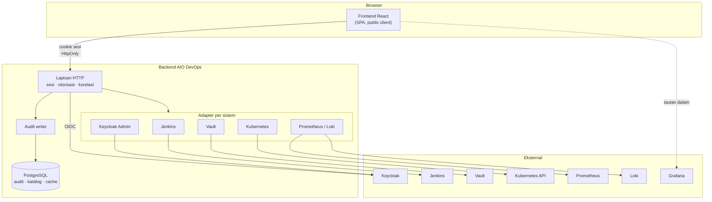

# Rancangan Platform AIO DevOps

Dokumen rancangan tingkat sistem untuk mengubah AIO DevOps dari dashboard frontend
menjadi platform operasional yang terintegrasi dengan Keycloak, Jenkins, Vault,
Kubernetes, serta Prometheus/Loki/Grafana — dengan hak akses per fitur dan audit
log menyeluruh.

> **Status: draf awal untuk didiskusikan.** Belum ada keputusan yang final.
> Bagian [Pertanyaan terbuka](#15-pertanyaan-terbuka) berisi hal-hal yang perlu
> dijawab sebelum implementasi dimulai — beberapa di antaranya mengubah bentuk
> rancangan ini secara mendasar, bukan sekadar detailnya.

> ⚠️ **Sebagian sudah digantikan.** Model lingkungan dan daftar peran di dokumen
> ini **tidak lagi berlaku** — lihat [`rbac-keycloak-jenkins.md`](./rbac-keycloak-jenkins.md),
> yang menetapkan empat lingkungan (development, qa, sandbox, production) dan lima
> peran (developer, qa engineer, enterprise architect, devops, it ops), serta izin
> yang berlingkup lingkungan. Bagian [4](#4-model-domain-inti) dan
> [6](#6-otorisasi) di bawah dibaca sebagai latar belakang, bukan sebagai
> spesifikasi.

---

## Dokumen di folder ini

| Dokumen                                                                      | Isi                                                       |
| ---------------------------------------------------------------------------- | --------------------------------------------------------- |
| `README.md` (ini)                                                            | Rancangan tingkat sistem: prinsip, peta, integrasi, audit |
| [`rbac-keycloak-jenkins.md`](./rbac-keycloak-jenkins.md)                     | Katalog peran Keycloak & akses Jenkins per lingkungan     |
| [`rbac-keycloak-jenkins-keputusan.md`](./rbac-keycloak-jenkins-keputusan.md) | Jawaban atas pertanyaan terbuka RBAC + penyesuaiannya     |

---

## Daftar isi

1. [Ruang lingkup & tujuan](#1-ruang-lingkup--tujuan)
2. [Prinsip rancangan](#2-prinsip-rancangan)
3. [Peta sistem](#3-peta-sistem)
4. [Model domain inti](#4-model-domain-inti)
5. [Autentikasi & sesi](#5-autentikasi--sesi)
6. [Otorisasi](#6-otorisasi)
7. [Meneruskan identitas ke sistem hilir](#7-meneruskan-identitas-ke-sistem-hilir)
8. [Audit log](#8-audit-log)
9. [Integrasi per sistem](#9-integrasi-per-sistem)
10. [Kontrak API](#10-kontrak-api)
11. [Data real-time & streaming](#11-data-real-time--streaming)
12. [Ketahanan & degradasi](#12-ketahanan--degradasi)
13. [Dampak ke frontend yang sudah ada](#13-dampak-ke-frontend-yang-sudah-ada)
14. [Tahapan pengerjaan](#14-tahapan-pengerjaan)
15. [Pertanyaan terbuka](#15-pertanyaan-terbuka)

---

## 1. Ruang lingkup & tujuan

### Yang dibangun

Satu tempat bagi tim rekayasa untuk menjawab pertanyaan operasional sehari-hari
tanpa berpindah-pindah antara enam antarmuka yang masing-masing punya login,
istilah, dan model izinnya sendiri:

| Pertanyaan                         | Hari ini dijawab di         | Nanti dijawab di          |
| ---------------------------------- | --------------------------- | ------------------------- |
| Siapa yang merilis ini, dan kapan? | Jenkins                     | Modul Deployments         |
| Kenapa gagal?                      | Jenkins → Kubernetes → Loki | Halaman detail deployment |
| Layanannya sehat tidak?            | Grafana                     | Kartu kesehatan layanan   |
| Secret ini dipakai siapa saja?     | Vault CLI                   | Modul Secrets             |
| Siapa yang mengubah itu semalam?   | _(tidak terjawab)_          | Audit log                 |

Baris terakhir yang paling penting. Lima baris di atasnya adalah kenyamanan —
menghemat perpindahan tab. Baris terakhir adalah kemampuan yang memang belum ada
sama sekali, dan ia hanya bisa ada kalau setiap tindakan lewat satu pintu.

### Yang tidak dibangun

Menyebutkan ini di awal sama pentingnya, karena ketiadaannya akan sering terasa
seperti kekurangan padahal disengaja:

- **Bukan pengganti Grafana.** Untuk penelusuran bebas — memilih metrik acak,
  menyusun query PromQL, membandingkan tujuh panel — Grafana lebih baik dan akan
  tetap lebih baik. Platform ini menyajikan pandangan yang sudah ditentukan
  bentuknya dan menyediakan tautan dalam ke Grafana untuk sisanya.
- **Bukan pengganti Jenkins.** Menyusun pipeline, mengelola agent, dan menulis
  Jenkinsfile tetap di Jenkins.
- **Bukan pengganti `kubectl`.** Yang disediakan adalah pandangan baca dan
  segelintir aksi yang aman dan sering (restart deployment, gulir balik). Debug
  mendalam tetap butuh kubectl.
- **Bukan sistem CD.** Platform ini _memicu_ dan _mengamati_; yang mengeksekusi
  tetap Jenkins dan Kubernetes.

Godaan terbesar dalam project seperti ini adalah perlahan membangun ulang keempat
alat di atas dengan versi yang lebih buruk. Batas di atas ada supaya penolakan
punya dasar yang bisa dirujuk.

---

## 2. Prinsip rancangan

Enam prinsip berikut menentukan hampir seluruh keputusan di dokumen ini. Kalau
salah satunya ditinggalkan, banyak bagian lain ikut berubah.

### P1 — Backend adalah satu-satunya pintu

Frontend tidak pernah berbicara langsung ke Keycloak, Jenkins, Vault, Kubernetes,
Prometheus, atau Loki. Semua lewat backend.

Ini bukan soal kerapian arsitektur. Ini konsekuensi langsung dari kebutuhan audit:
**audit log yang punya jalan pintas bukan audit log.** Kalau frontend bisa
memanggil Jenkins langsung, maka pengguna yang membuka devtools juga bisa — dan
tindakan itu tidak akan pernah tercatat. Ditambah lagi, kredensial ke sistem hilir
mustahil disimpan dengan aman di kode yang dikirim ke browser.

### P2 — Rahasia tidak pernah sampai ke browser

Nilai secret dari Vault, token Jenkins, kubeconfig, dan kredensial apa pun tidak
pernah dikirim ke frontend sebagai bagian dari alur biasa. Frontend mengelola
_referensi_ dan _metadata_ secret; membuka nilainya adalah tindakan terpisah yang
diminta secara sadar, dibatasi izin, berumur pendek, dan dicatat.

### P3 — Otorisasi diputuskan di backend; frontend hanya menyembunyikan

Pemeriksaan izin di frontend berguna untuk menyembunyikan hal yang bukan urusan
pengguna, dan tidak berguna untuk mengamankannya — semuanya berjalan di browser
dan bisa dimatikan siapa pun. Setiap endpoint backend memeriksa izinnya sendiri,
tanpa berasumsi UI sudah menyaring.

Prinsip ini sudah berlaku di kode yang ada; lihat catatan panjang di
`src/features/auth/permissions.ts`.

### P4 — Izin, bukan peran, yang diperiksa

Komponen dan endpoint menanyakan "boleh melakukan apa", bukan "siapa
penggunanya". Peran dipetakan ke izin di satu tempat. Menambah peran keempat
berarti menambah satu baris pemetaan, bukan berburu `role === 'admin'` di seluruh
kode.

### P5 — Setiap integrasi boleh mati sendiri-sendiri

Vault mati tidak boleh membuat halaman deployment kosong. Prometheus lambat tidak
boleh membuat daftar pod gagal dimuat. Setiap widget mengurus keadaan memuat,
gagal, kosong, dan berisinya sendiri — pola yang sudah dipakai `<QueryState>` di
frontend saat ini, dan yang harus tercermin juga di bentuk API-nya.

### P6 — Tindakan yang mengubah keadaan dicatat sebelum dianggap selesai

Audit bukan efek samping yang ditulis kalau sempat. Ia bagian dari definisi
"berhasil".

---

## 3. Peta sistem



Yang perlu diperhatikan dari gambar ini: **tidak ada satu pun panah dari Browser
ke kotak Eksternal**, kecuali tautan dalam ke Grafana yang dibuka pengguna secara
sadar di tab baru. Itu prinsip P1 dalam bentuk gambar.

---

## 4. Model domain inti

Sebelum membicarakan integrasi, perlu ada kosakata bersama. Tanpanya, "production"
berarti folder di Jenkins, namespace di Kubernetes, path di Vault, dan label di
Prometheus — empat hal berbeda yang kebetulan bernama sama, dan tidak ada yang
menghubungkannya.

### Empat entitas

**`Environment`** — production, staging, sandbox. Inilah sumbu utama hak akses:
seseorang boleh merilis ke staging tapi tidak ke production. Setiap environment
memuat pemetaan ke sistem hilir:

```
Environment { id, name, jenkinsFolder, k8sCluster, k8sNamespace,
              vaultMount, prometheusLabels, grafanaFolderUid }
```

**`Service`** — satu unit yang dirilis: `api-gateway`, `billing-service`. Sebuah
service ada di beberapa environment sekaligus.

```
Service { id, name, repo, owner, jenkinsJob, k8sWorkload, ... }
```

**`Actor`** — yang melakukan sesuatu. Bisa manusia (dari Keycloak) atau otomasi
(service account, webhook Jenkins). Dibedakan karena keduanya muncul di audit log
dan tidak boleh disamakan.

**`AuditEvent`** — catatan bahwa seorang Actor melakukan sesuatu terhadap sesuatu.
Dibahas di [bagian 8](#8-audit-log).

### Katalog sebagai sumber pemetaan

Pemetaan environment → (folder Jenkins, namespace K8s, mount Vault, label
Prometheus) tinggal di basis data backend, bukan tersebar sebagai konstanta di
adapter masing-masing. Alasannya praktis: menambah environment baru adalah
pekerjaan yang sering terjadi, dan kalau ia menuntut deploy ulang backend, orang
akan mencari jalan pintas.

Katalog service sebaiknya **diturunkan**, bukan diketik: dari label pada workload
Kubernetes, dari struktur folder Jenkins, atau dari repositori manifest. Katalog
yang diisi manual akan basi dalam hitungan minggu, dan katalog basi lebih
berbahaya daripada tidak ada katalog — orang telanjur memercayainya.

---

## 5. Autentikasi & sesi

### Keputusan: BFF, bukan token di browser

Ada dua cara memakai Keycloak dari SPA:

|                          | (a) SPA sebagai public client                | (b) BFF — backend sebagai confidential client |
| ------------------------ | -------------------------------------------- | --------------------------------------------- |
| Yang memegang token      | Browser                                      | Backend                                       |
| Yang dipegang browser    | Access + refresh token                       | Cookie sesi `HttpOnly`                        |
| Alur                     | Authorization Code + PKCE di browser         | Authorization Code + PKCE di backend          |
| Risiko XSS mencuri token | Ada                                          | Tidak — token tidak pernah ada di JS          |
| Streaming (SSE)          | Sulit: `EventSource` tidak bisa kirim header | Wajar: cookie ikut otomatis                   |
| Logout menyeluruh        | Sulit dijamin                                | Mudah: hapus sesi di backend                  |
| Kerumitan backend        | Rendah                                       | Sedang: perlu penyimpanan sesi                |

**Rekomendasi: (b), pola BFF.**

Alasan utamanya bukan XSS — meski itu nyata — melainkan bahwa backend memang sudah
harus ada untuk semua hal lain. Begitu backend ada, membuat browser memegang token
OIDC hanya menambah permukaan risiko tanpa menyederhanakan apa pun. Ditambah lagi,
log Jenkins dan log pod adalah _streaming_, dan `EventSource` tidak bisa mengirim
header `Authorization` — dengan cookie, streaming bekerja tanpa akal-akalan.

Frontend saat ini menyimpan access token di memori dan refresh token di cookie
`HttpOnly`. Perpindahan ke BFF berarti menghapus lapisan token di frontend
sepenuhnya dan menyisakan penanda sesi — perubahan yang **memperkecil** kode
frontend, bukan memperbesarnya.

### Alur masuk

```mermaid
sequenceDiagram
    participant B as Browser
    participant A as Backend
    participant K as Keycloak

    B->>A: GET /auth/login?returnTo=/deployments
    A->>A: buat state + PKCE verifier, simpan di sesi sementara
    A-->>B: 302 ke Keycloak (code + PKCE challenge)
    B->>K: login (bisa lewat SSO korporat)
    K-->>B: 302 ke /auth/callback?code&state
    B->>A: GET /auth/callback?code&state
    A->>K: tukar code + verifier → tokens
    K-->>A: id_token, access_token, refresh_token
    A->>A: validasi iss, aud, exp, sig; buat sesi
    A-->>B: Set-Cookie sesi (HttpOnly, Secure, SameSite=Lax) + 302 ke returnTo
```

### Hal yang mudah terlewat

- **Validasi `aud`.** Memeriksa bahwa token ditandatangani Keycloak saja tidak
  cukup — harus dipastikan token itu memang diterbitkan _untuk backend ini_.
  Tanpa itu, token yang sah untuk klien lain di realm yang sama akan diterima.
- **CSRF.** Sesi berbasis cookie berarti setiap request yang mengubah keadaan
  perlu perlindungan CSRF: `SameSite=Lax` sebagai dasar, ditambah pemeriksaan
  header `Origin` untuk `POST`/`PUT`/`PATCH`/`DELETE`.
- **Umur sesi ≠ umur token.** Access token Keycloak berumur menit; sesi aplikasi
  berumur jam. Backend memperbarui token di latar belakang; pengguna tidak pernah
  melihatnya.
- **Back-channel logout.** Keycloak bisa memberi tahu backend saat sesi
  dihentikan dari sisi Keycloak (admin menonaktifkan akun). Tanpa mendengarkan
  itu, akun yang dinonaktifkan tetap bisa memakai platform sampai sesinya
  kedaluwarsa sendiri.

---

## 6. Otorisasi

### Dua lapis, dengan tanggung jawab berbeda

**Lapis 1 — Keycloak** memutuskan _siapa_ pengguna dan _peran_ apa yang ia punya.
Peran didefinisikan sebagai client role pada client `aio-devops`, dan diberikan
lewat group Keycloak (bukan langsung ke user) supaya pengelolaannya mengikuti
struktur tim.

**Lapis 2 — backend** memetakan peran menjadi izin, lalu memeriksa izin pada
setiap endpoint. Frontend memakai pemetaan yang sama untuk menyembunyikan menu dan
tombol.

### Kosakata izin

Mengikuti pola `<objek>:<aksi>` yang sudah dipakai di frontend:

| Domain        | Izin                                                               |
| ------------- | ------------------------------------------------------------------ |
| Deployment    | `deployment:read`, `deployment:run`, `deployment:rollback`         |
| Pipeline      | `pipeline:read`, `pipeline:trigger`, `pipeline:abort`              |
| Secret        | `secret:list`, `secret:read`, `secret:write`, `secret:delete`      |
| Cluster       | `cluster:read`, `cluster:exec`, `cluster:restart`, `cluster:scale` |
| Observability | `metrics:read`, `logs:read`                                        |
| Audit         | `audit:read`, `audit:export`                                       |
| Administrasi  | `user:manage`, `settings:manage`, `catalog:manage`                 |

Perhatikan `secret:list` dipisah dari `secret:read`: mengetahui _ada_ secret
bernama `billing/stripe-key` adalah informasi yang jauh berbeda dari mengetahui
_isinya_. Pemisahan serupa berlaku di `cluster:read` versus `cluster:exec`.

### Izin berbasis lingkup, bukan global

Izin saja tidak cukup. "Boleh merilis" hampir selalu berarti "boleh merilis
**layanan tertentu** ke **environment tertentu**". Bentuk pemeriksaannya:

```
can(actor, 'deployment:run', { environment: 'production', service: 'billing' })
```

Cara paling sederhana yang tetap benar: peran Keycloak dinamai berlingkup
(`deploy-production`, `deploy-staging`), lalu backend menerjemahkannya jadi
pasangan izin+lingkup. Model yang lebih kaya (per service) sebaiknya menunggu
sampai memang dibutuhkan — dan pertanyaannya ada di
[bagian 15](#15-pertanyaan-terbuka).

> Bagian ini **digantikan** [`rbac-keycloak-jenkins.md`](./rbac-keycloak-jenkins.md),
> yang menurunkan model di bawah jadi katalog peran Keycloak yang lengkap beserta
> pemetaannya ke Jenkins. Yang tetap berlaku dari sini adalah prinsipnya: dua
> lapis, izin bukan peran, dan izin berlingkup.

### Peran awal yang diusulkan

| Peran       | Ringkasnya                                           |
| ----------- | ---------------------------------------------------- |
| `viewer`    | Baca semuanya kecuali isi secret dan audit log       |
| `developer` | `viewer` + memicu pipeline & rilis ke non-production |
| `operator`  | `developer` + rilis production, restart, gulir balik |
| `security`  | `viewer` + kelola secret + baca audit log            |
| `admin`     | Semuanya, termasuk katalog dan pengguna              |

`security` sengaja bukan bagian dari tangga `viewer → developer → operator`.
Peran yang mengelola secret dan membaca audit tidak harus juga bisa merilis ke
production; menumpuk semuanya di satu peran tertinggi menghilangkan gunanya
pemisahan tugas.

---

## 7. Meneruskan identitas ke sistem hilir

Ini bagian yang paling mudah dirancang keliru, dan akibatnya baru terasa saat
insiden — ketika audit log Vault atau Kubernetes ternyata hanya berisi satu nama:
nama service account platform.

Ada dua pilihan untuk setiap sistem hilir:

- **Service account** — backend memakai satu kredensial. Sederhana, tapi sistem
  hilir tidak tahu siapa manusianya. Jejaknya hanya ada di audit log kita.
- **Identitas diteruskan** — backend memakai identitas pengguna. Sistem hilir
  menerapkan RBAC-nya sendiri dan mencatat nama yang sebenarnya. Jauh lebih baik,
  tapi tidak semua sistem mendukungnya.

Yang diusulkan, per sistem:

| Sistem                 | Cara                            | Catatan                                                                                                                          |
| ---------------------- | ------------------------------- | -------------------------------------------------------------------------------------------------------------------------------- |
| **Vault**              | Identitas diteruskan            | Vault `auth/jwt` menerima token Keycloak; policy Vault diikat ke group. Audit device Vault mencatat nama pengguna sebenarnya.    |
| **Kubernetes**         | Identitas diteruskan            | API server dikonfigurasi dengan OIDC issuer Keycloak. RBAC klaster berlaku per pengguna; audit log K8s mencatat nama sebenarnya. |
| **Jenkins**            | Service account per environment | Remote API Jenkins bertumpu pada API token, bukan OIDC. Nama pemicu dikirim sebagai parameter build dan dicatat di audit kita.   |
| **Prometheus/Loki**    | Service account                 | Read-only; tidak ada tindakan yang perlu diatributkan. Penyaringan per-tenant dilakukan backend lewat label.                     |
| **Keycloak Admin API** | Service account khusus          | Client terpisah dengan `client_credentials` dan peran seminimal mungkin.                                                         |

Untuk Vault dan Kubernetes, token yang dipegang backend perlu punya `aud` yang
sesuai. Kalau audiens-nya berbeda dari audiens backend, gunakan **token exchange**
(RFC 8693) yang didukung Keycloak — jangan meneruskan token backend apa adanya dan
berharap sistem hilir menerimanya.

> **Konsekuensi yang harus disadari:** dengan identitas diteruskan, seorang
> pengguna bisa gagal di Vault atau Kubernetes meski lolos pemeriksaan izin
> platform. Itu benar dan memang diinginkan — tapi UI harus bisa membedakan
> "kamu tidak berhak menurut platform" dari "kamu tidak berhak menurut Vault",
> karena tindak lanjutnya berbeda. Lihat [bagian 10](#10-kontrak-api).

---

## 8. Audit log

Bagian ini adalah alasan platform ini ada. Kalau bagian lain dikerjakan setengah
jadi, platformnya tetap berguna; kalau bagian ini setengah jadi, platformnya
justru berbahaya — orang akan memercayai catatan yang tidak lengkap.

### Bentuk satu catatan

```
AuditEvent {
  id            ULID          -- terurut waktu, aman dibuat terdistribusi
  occurredAt    timestamptz
  correlationId string        -- menyambung ke log & trace request yang sama
  actor         { type: 'user'|'service', id, name, email, roles[] }
  action        string        -- 'deployment.run', 'secret.read', …
  resource      { type, id, environment?, service? }
  outcome       'success' | 'denied' | 'error'
  reason        string?       -- kenapa ditolak, atau pesan errornya
  source        { ip, userAgent }
  details       jsonb         -- payload yang sudah disaring, lihat di bawah
}
```

### Enam keputusan yang menentukan kualitasnya

**1. Ditulis backend, tidak pernah frontend.** Catatan yang dikirim klien adalah
catatan yang bisa dikarang klien.

**2. Ditulis untuk penolakan juga, bukan hanya keberhasilan.** `outcome: 'denied'`
adalah baris paling menarik saat menyelidiki insiden: sepuluh percobaan gagal
membuka secret produksi jam tiga pagi jauh lebih berarti daripada satu
keberhasilan.

**3. Append-only, dan aplikasi tidak punya cara menghapus.** Tidak ada endpoint
`DELETE`. Di tingkat basis data, `REVOKE UPDATE, DELETE` pada tabelnya untuk role
yang dipakai aplikasi. Retensi diurus proses terpisah dengan kredensial berbeda.

**4. `details` memakai daftar-boleh, bukan daftar-larang.** Naluri pertama adalah
menyaring field bernama `password`, `token`, `secret`. Itu selalu kalah: field
berikutnya akan bernama `apiKeyV2` dan tidak ada yang ingat memperbaruinya. Yang
benar adalah menyebutkan field mana yang **boleh** dicatat per jenis aksi;
selebihnya tidak ikut. Nilai secret **tidak pernah** masuk ke `details`, bahkan
tersamarkan — yang dicatat adalah path dan versinya.

**5. Membaca audit log adalah tindakan yang diaudit.** `audit.read` menghasilkan
catatan seperti tindakan lain.

**6. Terpisah dari log aplikasi.** Log aplikasi masuk ke Loki: bervolume besar,
retensi pendek, boleh hilang. Audit log masuk ke basis data: bervolume kecil,
retensi panjang (usulan: 2 tahun), tidak boleh hilang. Menggabungkan keduanya
berarti memberi audit sifat terburuk dari log aplikasi.

### Korelasi

Setiap request menerima `X-Request-Id` (dibuat frontend atau edge, dilanjutkan
backend). Id itu ikut ke audit event, ke log terstruktur backend, dan diteruskan
ke sistem hilir bila memungkinkan. Hasilnya: dari satu baris audit, seseorang bisa
melompat ke seluruh log teknis dari tindakan yang sama — dan itu perbedaan antara
audit log yang bisa dipakai menyelidiki dan audit log yang cuma bisa dipakai
melapor.

### Apa yang dicatat

Semua yang mengubah keadaan, plus pembacaan yang sensitif:

| Kategori     | Contoh aksi                                                   |
| ------------ | ------------------------------------------------------------- |
| Sesi         | `auth.login`, `auth.logout`, `auth.denied`                    |
| Deployment   | `deployment.run`, `deployment.cancel`, `deployment.rollback`  |
| Pipeline     | `pipeline.trigger`, `pipeline.abort`                          |
| Secret       | `secret.list`, `secret.read`, `secret.write`, `secret.delete` |
| Klaster      | `cluster.restart`, `cluster.scale`, `cluster.exec`            |
| Administrasi | `role.grant`, `catalog.update`, `settings.update`             |
| Audit        | `audit.read`, `audit.export`                                  |

Pembacaan biasa (melihat daftar deployment, membuka grafik) **tidak** dicatat.
Mencatat semuanya menghasilkan jutaan baris yang menyembunyikan yang penting —
audit log yang terlalu berisik sama tidak bergunanya dengan yang terlalu sepi.

---

## 9. Integrasi per sistem

### 9.1 Keycloak

Selain autentikasi ([bagian 5](#5-autentikasi--sesi)), Keycloak dipakai sebagai
sumber data pengguna untuk halaman administrasi: daftar pengguna, group, dan
peran. Diakses lewat Admin REST API dengan client `client_credentials` terpisah
yang hanya punya peran `view-users` dan `manage-users` bila memang perlu.

Perubahan keanggotaan group dilakukan di Keycloak, bukan di platform — kecuali
memang diputuskan sebaliknya, dan kalau begitu setiap perubahan wajib menghasilkan
`role.grant` di audit log.

### 9.2 Jenkins

**Yang dipakai:** REST API + `crumb` untuk CSRF.

| Kebutuhan     | Endpoint Jenkins                                      |
| ------------- | ----------------------------------------------------- |
| Daftar job    | `/api/json?tree=jobs[...]`                            |
| Riwayat build | `/job/<x>/api/json?tree=builds[...]`                  |
| Memicu build  | `POST /job/<x>/buildWithParameters`                   |
| Status build  | `/job/<x>/<n>/api/json`                               |
| Log bertahap  | `/job/<x>/<n>/logText/progressiveText?start=<offset>` |
| Membatalkan   | `POST /job/<x>/<n>/stop`                              |

**Hal penting:** memicu build menghasilkan _queue item_, bukan build. Nomor build
baru ada setelah antreannya diproses. Backend harus menyimpan queue id dan
memetakannya ke build id saat sudah tersedia — kalau tidak, UI akan menampilkan
"berhasil dipicu" tanpa pernah bisa menunjukkan buildnya.

**Log:** `progressiveText` mengembalikan header `X-Text-Size` dan `X-More-Data`.
Backend melakukan polling dengan offset lalu meneruskannya ke frontend sebagai
SSE. Frontend tidak pernah tahu ada polling di baliknya.

**Alternatif yang lebih baik bila memungkinkan:** Jenkins mengirim webhook ke
backend saat build selesai, sehingga status tidak perlu di-poll sama sekali.
Kandidat untuk tahap berikutnya, bukan tahap pertama.

### 9.3 Vault

**Yang dipakai:** KV v2, `auth/jwt` dengan token Keycloak.

Yang dilakukan platform:

- Menelusuri path dan menampilkan **metadata**: nama, versi, kapan diubah, oleh
  siapa, siapa yang berhak.
- Membuat dan memperbarui secret.
- Menampilkan nilai — sebagai tindakan terpisah, di balik `secret:read`, dengan
  konfirmasi, dan dicatat.

Aturan teknis yang mengikat frontend:

> Nilai secret **tidak boleh** masuk ke cache TanStack Query. Ia diambil lewat
> _mutation_, bukan _query_, sehingga tidak pernah tersimpan di `queryClient`,
> tidak ikut ter-refetch, dan hilang saat komponennya dilepas. Nilai yang tampil
> juga disembunyikan kembali setelah tenggang waktu tertentu.

Alasannya sederhana: `queryClient` menyimpan hasil di memori dan membagikannya ke
komponen mana pun yang memakai key yang sama. Itu sifat yang sangat berguna untuk
daftar deployment dan sangat tidak diinginkan untuk kredensial produksi.

### 9.4 Kubernetes

**Yang dipakai:** API server langsung dengan token pengguna (OIDC).

Baca: Deployment, StatefulSet, Pod, ReplicaSet, Event, Ingress, HPA. Aksi tulis
yang diusulkan, sengaja sedikit:

| Aksi                | Izin                  | Catatan                                           |
| ------------------- | --------------------- | ------------------------------------------------- |
| Restart rollout     | `cluster:restart`     | Patch anotasi `kubectl.kubernetes.io/restartedAt` |
| Gulir balik         | `deployment:rollback` | Ke revisi sebelumnya                              |
| Ubah jumlah replika | `cluster:scale`       | Dengan batas atas dari katalog                    |

**`exec` ke dalam pod sengaja tidak masuk tahap awal.** Ia butuh WebSocket dua
arah, mustahil diaudit secara bermakna (apa yang diketik seseorang di dalam shell
bukan sesuatu yang bisa dicatat dengan jujur oleh proxy), dan merupakan jalan
memutar untuk semua pembatasan lain. Kalau memang dibutuhkan, ia layak jadi
keputusan tersendiri — bukan menumpang di sini.

**Log pod:** `GET /api/v1/namespaces/<ns>/pods/<pod>/log?follow=true` menghasilkan
aliran; backend meneruskannya sebagai SSE.

### 9.5 Prometheus, Loki, Grafana

**Prometheus.** `/api/v1/query` untuk angka sesaat (kartu kesehatan),
`/api/v1/query_range` untuk grafik. Query **tidak** disusun frontend — frontend
meminta _nama pandangan_ (`service-health`, `error-rate`) beserta parameternya,
dan backend yang menyimpan PromQL-nya.

Ini keputusan yang perlu ditegaskan: PromQL yang dikirim klien berarti klien bisa
mengirim query apa pun, termasuk yang menjatuhkan Prometheus. Ia juga membuat
setiap perbaikan query menuntut rilis frontend.

**Loki.** `/loki/api/v1/query_range` untuk pencarian, `/loki/api/v1/tail`
(WebSocket) untuk aliran langsung. Selektor label selalu ditambah backend
berdasarkan environment dan service yang sedang dibuka, sehingga pengguna tidak
bisa membaca log di luar lingkupnya dengan menyusun selektor sendiri.

**Grafana.** Tidak di-proxy. Platform menyediakan tautan dalam ke dashboard yang
sudah tersaring:

```
{grafanaUrl}/d/{uid}?var-service={service}&var-env={env}&from={from}&to={to}
```

Menyematkan Grafana lewat iframe sempat dipertimbangkan dan tidak disarankan:
autentikasinya menuntut anonymous access atau proxy header, temanya tidak akan
cocok dengan aplikasi, dan CSP jadi berlubang. Tautan dalam memberi 80% manfaat
dengan 5% kerumitan.

---

## 10. Kontrak API

Melanjutkan konvensi yang sudah dipakai frontend hari ini, supaya lapisan HTTP,
penanganan error, dan komponen keadaan yang sudah ada tidak perlu ditulis ulang.

### Bentuk yang sudah ada dan dipertahankan

- **Daftar berhalaman** memakai amplop `Paginated<T>`:
  `{ items, page, pageSize, total, pageCount }`.
- **Kesalahan** membawa `{ message }` berbahasa Indonesia yang layak ditampilkan
  apa adanya.
- **Kesalahan validasi** membawa `{ errors: { <field>: <pesan> } }` sehingga
  pesannya mendarat di field yang tepat.
- **Penyaring dikirim sebagai query string**, dan tercermin di URL halaman
  sehingga bisa disalin dan dibagikan.

### Yang perlu ditambahkan

**Taksonomi kesalahan hulu.** UI harus bisa membedakan hal-hal yang tampak sama
tapi menuntut tindak lanjut berbeda:

| Status                          | Arti                 | Yang dilihat pengguna                       |
| ------------------------------- | -------------------- | ------------------------------------------- |
| `401`                           | Sesi berakhir        | Diarahkan ke login                          |
| `403`                           | Ditolak platform     | "Anda tidak punya akses ke ini"             |
| `403` + `code: upstream_denied` | Ditolak sistem hilir | "Vault menolak: policy X tidak mengizinkan" |
| `424`                           | Sistem hilir mati    | "Jenkins sedang tidak dapat dihubungi"      |
| `504`                           | Sistem hilir lambat  | "Jenkins tidak merespons tepat waktu"       |

Membedakan `403` platform dari `403` hilir penting karena tindak lanjutnya
berbeda: yang pertama minta peran ke admin platform, yang kedua minta policy ke
tim keamanan.

**Status integrasi.** Satu endpoint `GET /integrations/status` yang melaporkan
kesehatan tiap sistem hilir, sehingga UI bisa menampilkan "Vault tidak dapat
dihubungi" sebagai keterangan kecil di tempatnya — bukan sebagai halaman error
yang menutup segalanya (prinsip P5).

---

## 11. Data real-time & streaming

Empat hal butuh pembaruan berjalan: status build, log build, status rollout, dan
log pod. Rekomendasi transportnya:

| Kebutuhan              | Transport                     | Alasan                                                                                                              |
| ---------------------- | ----------------------------- | ------------------------------------------------------------------------------------------------------------------- |
| Log build & log pod    | **SSE**                       | Satu arah, lewat proxy dengan mulus, sambung ulang otomatis, dan ikut cookie sesi                                   |
| Status build & rollout | **Polling** `refetchInterval` | Perubahannya jarang; polling 3–5 detik jauh lebih sederhana daripada soket, dan TanStack Query sudah menyediakannya |
| Tail Loki              | **WebSocket**                 | Dipaksa oleh API Loki; hanya di halaman yang memang meminta                                                         |

Prinsipnya: **SSE sebagai default, WebSocket hanya bila dipaksa hulu.** Soket dua
arah menuntut penanganan sambung ulang, urutan pesan, dan tekanan balik yang
semuanya harus ditulis sendiri — biaya yang hanya sepadan kalau memang butuh
mengirim data ke arah sebaliknya, dan di sini tidak.

Semua aliran melewati backend. Backend membatasi jumlah aliran per pengguna,
memutusnya saat sesi berakhir, dan menghentikan aliran yang tidak lagi dibaca.

---

## 12. Ketahanan & degradasi

**Cache di backend, bukan hanya di browser.** Query Prometheus mahal dan sering
diulang oleh banyak pengguna sekaligus. Cache pendek (10–30 detik) di backend
memotong beban jauh lebih efektif daripada cache di masing-masing browser.

**Batas laju per pengguna dan per sistem hilir.** Satu halaman yang terbuka di
sepuluh monitor tidak boleh menjatuhkan Jenkins.

**Timeout yang lebih pendek daripada kesabaran pengguna.** Setiap panggilan hilir
punya batas waktu eksplisit, dan `504` dengan pesan yang jelas lebih baik daripada
permintaan yang menggantung.

**Circuit breaker per integrasi.** Kalau Vault gagal sepuluh kali berturut-turut,
berhenti mencoba selama satu menit dan langsung jawab `424`. Ini melindungi
platform dari ikut lambat gara-gara satu sistem hilir bermasalah — dan melindungi
sistem hilir dari dihujani permintaan saat sedang pulih.

**Degradasi yang terlihat, bukan yang disembunyikan.** Saat Prometheus mati,
kartu metrik menampilkan keadaan gagal beserta tombol coba lagi; daftar deployment
di sebelahnya tetap normal. Pola ini sudah berjalan di frontend saat ini.

---

## 13. Dampak ke frontend yang sudah ada

Kabar baiknya: rancangan ini sebagian besar **menambah**, bukan mengubah. Struktur
yang sudah ada memang disiapkan untuk ini.

| Bagian                             | Perubahan                                                                                            |
| ---------------------------------- | ---------------------------------------------------------------------------------------------------- |
| `src/services/http.ts`             | `credentials: 'include'` jadi default; header `Authorization` dilepas (BFF); tambah `X-Request-Id`   |
| `src/features/auth/session.ts`     | Menyusut: tidak ada lagi token di memori, tinggal status sesi                                        |
| `src/features/auth/permissions.ts` | Daftar izin bertambah; `can()` menerima lingkup (environment/service)                                |
| `src/routes/routes.ts`             | Satu entri per modul baru — pola yang sudah dipakai                                                  |
| `src/services/<domain>/`           | Satu folder per domain baru: pipelines, secrets, cluster, observability, audit                       |
| `src/features/<domain>/`           | Komponen per domain, memanggil hook domainnya sendiri                                                |
| `src/components/ui/`               | Tambahan: `LogViewer`, `CodeBlock`, `Timeline`, `StatusDot`                                          |
| Mock                               | Setiap domain baru membawa `<domain>.mock.ts` sendiri — pengembangan frontend tidak menunggu backend |

Satu tambahan yang belum ada padanannya: **komponen aliran**. Log build dan log
pod butuh pembungkus setara `<QueryState>` tapi untuk SSE — menangani menyambung,
tersambung, terputus, dan menyambung ulang. Layak dibuat sekali di
`src/components/StreamState.tsx` dengan alasan yang sama seperti `<QueryState>`:
kalau diserahkan ke tiap halaman, akan ada halaman yang lupa menangani putusnya
koneksi.

### Modul & route yang diusulkan

| Route            | Modul                | Izin              |
| ---------------- | -------------------- | ----------------- |
| `/`              | Dashboard            | `dashboard:read`  |
| `/deployments`   | Deployments          | `deployment:read` |
| `/pipelines`     | Pipelines (Jenkins)  | `pipeline:read`   |
| `/cluster`       | Workload & pod       | `cluster:read`    |
| `/observability` | Metrik & log         | `metrics:read`    |
| `/secrets`       | Secrets (Vault)      | `secret:list`     |
| `/audit`         | Audit log            | `audit:read`      |
| `/settings`      | Pengaturan & katalog | `settings:manage` |

---

## 14. Tahapan pengerjaan

Urutannya bukan dari yang paling mudah, melainkan dari yang paling menentukan
bentuk hal-hal berikutnya. Setiap tahap menghasilkan sesuatu yang bisa dipakai.

**Tahap 0 — Fondasi.** Backend berdiri, Keycloak terpasang dengan pola BFF, tabel
audit ada, kerangka izin jalan, `/integrations/status` hidup. Belum ada satu pun
integrasi. Yang bisa dilakukan: masuk, melihat halaman kosong, dan menemukan
`auth.login` di audit log. Terdengar sedikit, tapi ini tahap yang menentukan
semua bentuk setelahnya.

**Tahap 1 — Baca dari Kubernetes.** Daftar workload dan pod, detail, event, log.
Read-only. Integrasi pertama sengaja yang read-only supaya jalur identitas dan
penanganan error hilir teruji tanpa risiko.

**Tahap 2 — Observability.** Kartu kesehatan dari Prometheus, pencarian log Loki,
tautan dalam ke Grafana. Masih read-only. Setelah tahap ini, platform sudah
berguna sehari-hari meski belum bisa melakukan apa-apa.

**Tahap 3 — Jenkins, baca lalu tulis.** Daftar job dan build, log bertahap. Baru
kemudian memicu build dan membatalkan. **Inilah tindakan tulis pertama**, dan ia
sengaja ditaruh setelah audit log terbukti bekerja.

**Tahap 4 — Aksi klaster.** Restart, gulir balik, ubah replika.

**Tahap 5 — Vault.** Ditaruh terakhir dengan sengaja: ini integrasi yang paling
tidak memaafkan kesalahan, dan pada titik ini pola izin, audit, serta penanganan
error hilir sudah matang di empat integrasi sebelumnya.

**Tahap 6 — Administrasi.** Halaman audit log, pengelolaan katalog, pandangan
peran.

> Pola berulangnya: **baca sebelum tulis, dan audit sebelum tulis apa pun.**

---

## 15. Pertanyaan terbuka

Perlu dijawab sebelum implementasi dimulai. Yang bertanda ⚠️ mengubah bentuk
rancangan, bukan sekadar isinya.

1. **⚠️ Seberapa halus lingkup izinnya?** Cukup per environment, atau perlu per
   service? Yang kedua jauh lebih rumit — butuh pemetaan service→tim yang harus
   tetap mutakhir — dan sebaiknya hanya diambil kalau memang ada kebutuhannya
   sekarang.

2. **⚠️ Kubernetes memakai OIDC atau service account?** Kalau API server klaster
   belum terkonfigurasi dengan Keycloak sebagai OIDC provider, mengubahnya adalah
   pekerjaan infrastruktur tersendiri. Kalau tidak bisa, identitas tidak
   diteruskan dan audit klaster kehilangan nama sebenarnya.

3. **⚠️ Berapa banyak klaster, dan multi-tenant atau tidak?** Satu klaster dengan
   beberapa namespace jauh berbeda dari beberapa klaster di beberapa region.

4. **Boleh menampilkan nilai secret di UI sama sekali?** Sebagian organisasi
   melarangnya mutlak — UI hanya mengelola referensi. Jawabannya menentukan ada
   atau tidaknya seluruh alur `secret:read`.

5. **`exec` ke dalam pod: perlu?** Kalau ya, ia butuh rancangan tersendiri soal
   audit dan pembatasan.

6. **Retensi audit log berapa lama, dan ada kewajiban kepatuhan tertentu?**
   Menentukan apakah cukup PostgreSQL biasa atau perlu penyimpanan WORM.

7. **Jenkins bisa mengirim webhook ke platform?** Kalau bisa, seluruh polling
   status build bisa dihapus.

8. **Katalog service dari mana?** Label Kubernetes, repositori manifest, atau
   diisi manual? Menentukan seberapa cepat ia jadi basi.

9. **Berapa pengguna bersamaan yang diperkirakan?** Menentukan apakah sesi cukup
   disimpan di memori proses atau perlu Redis, dan apakah aliran SSE perlu
   dibatasi lebih ketat.

10. **Sudah ada standar backend di organisasi?** Bahasa dan kerangka kerjanya
    tidak dibahas di dokumen ini karena rancangan ini tidak bergantung padanya —
    tapi keputusannya perlu diambil sebelum tahap 0.

---

## Lampiran — ringkasan keputusan

| #   | Keputusan                                | Alternatif yang ditolak                  | Alasan singkat                                                      |
| --- | ---------------------------------------- | ---------------------------------------- | ------------------------------------------------------------------- |
| 1   | Backend jadi satu-satunya pintu          | Frontend memanggil sistem hilir langsung | Audit log yang bisa dilewati tidak ada gunanya                      |
| 2   | Pola BFF; token tidak di browser         | SPA sebagai public client                | Menghapus permukaan XSS; membuat SSE bekerja wajar                  |
| 3   | Izin, bukan peran, yang diperiksa        | `role === 'admin'` di tempat yang butuh  | Peran keempat tidak menuntut menyisir seluruh kode                  |
| 4   | Identitas diteruskan ke Vault & K8s      | Service account untuk semuanya           | Audit sistem hilir mencatat nama sebenarnya                         |
| 5   | Audit di PostgreSQL, bukan Loki          | Semua log jadi satu                      | Audit butuh retensi panjang dan tidak boleh hilang                  |
| 6   | `details` audit memakai daftar-boleh     | Menyaring field bernama sensitif         | Daftar-larang selalu ketinggalan satu field                         |
| 7   | Nilai secret lewat mutation, bukan query | `useQuery` seperti data lain             | Agar tidak pernah masuk cache                                       |
| 8   | PromQL disimpan backend                  | Frontend menyusun query                  | Mencegah query sembarang & rilis frontend untuk perbaikan query     |
| 9   | Grafana ditautkan, bukan disematkan      | iframe                                   | Autentikasi, tema, dan CSP tidak sepadan dengan manfaatnya          |
| 10  | SSE sebagai default streaming            | WebSocket di mana-mana                   | Satu arah sudah cukup; sambung ulang gratis                         |
| 11  | Vault dikerjakan terakhir                | Vault lebih dulu karena menarik          | Integrasi paling tidak memaafkan, dikerjakan saat pola sudah matang |

---

_Dokumen ini draf. Perbaiki di tempat, dan catat perubahan keputusan besar di
tabel lampiran supaya alasan penggantiannya tidak hilang._
