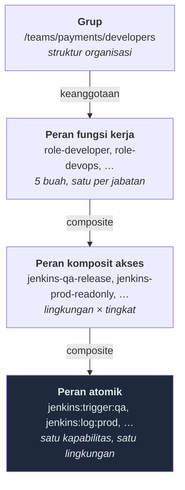
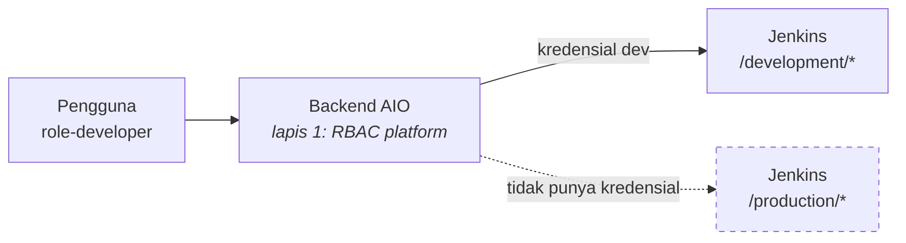
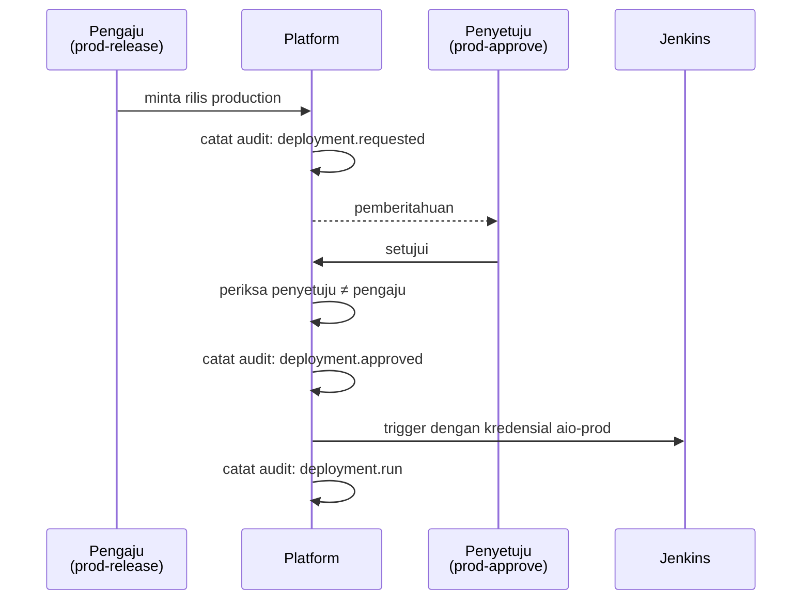

# RBAC: Keycloak & Jenkins

Rancangan hak akses untuk empat lingkungan (**development**, **qa**, **sandbox**,
**production**) dan lima peran (**developer**, **qa engineer**, **enterprise
architect**, **devops**, **it ops**), dengan Keycloak sebagai sumber identitas dan
Jenkins sebagai sistem pertama yang dikendalikan.

> **Status: draf untuk didiskusikan.** Bagian [Pertanyaan terbuka](#16-pertanyaan-terbuka)
> berisi hal-hal yang perlu dijawab sebelum implementasi. Dokumen induknya adalah
> [`README.md`](./README.md) di folder ini.

> ⚠️ **Sudah ada penyesuaian.** Kesepuluh pertanyaan terbuka di bawah **sudah
> dijawab** — lihat [`rbac-keycloak-jenkins-keputusan.md`](./rbac-keycloak-jenkins-keputusan.md),
> yang menambahkan lingkup kelompok job, banyak instance Jenkins, plafon tingkat
> per lingkungan, dan menghapus fitur persetujuan serta break-glass. Pertanyaan
> lanjutan yang muncul darinya juga sudah terjawab di sana. Yang berlaku adalah dokumen ini **plus**
> dokumen itu; bila keduanya berselisih, yang di sana yang menang. Tabel
> perubahan per bagian ada di lampirannya.

---

## Daftar isi

1. [Delta terhadap dokumen induk](#1-delta-terhadap-dokumen-induk)
2. [Model tiga lapis](#2-model-tiga-lapis)
3. [Empat lingkungan dan profil risikonya](#3-empat-lingkungan-dan-profil-risikonya)
4. [Kapabilitas Jenkins](#4-kapabilitas-jenkins)
5. [Empat tingkat akses](#5-empat-tingkat-akses)
6. [Katalog peran Keycloak](#6-katalog-peran-keycloak)
7. [Matriks peran × lingkungan](#7-matriks-peran--lingkungan)
8. [Peta ke akses yang diminta](#8-peta-ke-akses-yang-diminta)
9. [Penegakan berlapis](#9-penegakan-berlapis)
10. [Struktur folder Jenkins](#10-struktur-folder-jenkins)
11. [Persetujuan produksi & break-glass](#11-persetujuan-produksi--break-glass)
12. [Bentuk token & pemetaan](#12-bentuk-token--pemetaan)
13. [Audit](#13-audit)
14. [Konfigurasi sebagai kode](#14-konfigurasi-sebagai-kode)
15. [Dampak ke kode yang sudah ada](#15-dampak-ke-kode-yang-sudah-ada)
16. [Pertanyaan terbuka](#16-pertanyaan-terbuka)

---

## 1. Delta terhadap dokumen induk

Dokumen ini **mengganti** dua asumsi di [`README.md`](./README.md), bukan
melengkapinya. Perlu dicatat terang-terangan supaya tidak ada dua model yang
hidup berdampingan:

|             | Dokumen induk                                | Dokumen ini                                                      |
| ----------- | -------------------------------------------- | ---------------------------------------------------------------- |
| Lingkungan  | production, staging, sandbox                 | **development, qa, sandbox, production**                         |
| Peran       | viewer, developer, operator, security, admin | **developer, qa engineer, enterprise architect, devops, it ops** |
| Bentuk izin | `<objek>:<aksi>` global                      | `<objek>:<aksi>` **berlingkup lingkungan**                       |

Perubahan ketiga yang paling berdampak ke kode. Di dokumen induk, `can()` cukup
menerima satu izin; di sini ia harus menerima izin **beserta lingkupnya**, karena
"boleh menjalankan build" tanpa menyebut lingkungan mana adalah pernyataan yang
tidak berarti apa-apa. Rinciannya di [bagian 15](#15-dampak-ke-kode-yang-sudah-ada).

`staging` hilang dan digantikan `qa`. Keduanya bukan sinonim: `staging` biasanya
berarti "mirip produksi, untuk uji akhir", sedangkan `qa` adalah lingkungan milik
tim penguji dengan siklus dan pemiliknya sendiri. Kalau kelak keduanya
dibutuhkan sekaligus, yang bertambah cuma satu baris di daftar lingkungan —
seluruh struktur di bawah ini tidak berubah bentuk.

---

## 2. Model tiga lapis

Godaan terbesar dalam RBAC adalah membuat satu peran per kombinasi
(orang × lingkungan × tindakan). Itu bekerja sampai lingkungan kelima muncul,
lalu daftarnya meledak dan tidak ada lagi yang berani menghapus peran karena
tidak ada yang tahu siapa memakainya.

Karena itu tiga lapis, dengan aturan tegas siapa boleh menyentuh apa:



**Lapis atomik** — satu kapabilitas pada satu lingkungan. Inilah yang dibaca
backend saat memutuskan. Tidak pernah diberikan langsung ke manusia.

**Lapis akses** — `jenkins-<lingkungan>-<tingkat>`. Bahasa yang dipakai saat
membicarakan akses ("dia butuh `jenkins-qa-release`").

**Lapis fungsi kerja** — `role-developer` dan empat saudaranya. Inilah yang
dilekatkan ke grup.

**Grup** — struktur tim. Satu-satunya tempat manusia dimasukkan.

### Aturan yang membuat lapisan ini tetap berguna

1. **Manusia tidak pernah menerima peran langsung.** Hanya lewat keanggotaan
   grup. Kalau seseorang bisa punya peran di luar grupnya, offboarding berubah
   dari "keluarkan dari grup" jadi "cari semua tempat yang pernah memberinya
   sesuatu" — dan yang terlewat tidak menimbulkan gejala apa pun.
2. **Backend memeriksa lapis atomik, bukan nama fungsi kerja.** Perbandingan
   terhadap nama jabatan yang tersebar di kode adalah cara tercepat membuat peran
   keenam mustahil ditambahkan.
3. **Frontend memakai vokabuler yang sama** — untuk menyembunyikan tombol, bukan
   untuk mengamankan. Alasannya sudah ditulis panjang di
   `src/features/auth/permissions.ts`.

---

## 3. Empat lingkungan dan profil risikonya

Tingkat akses tidak dirancang seragam antar lingkungan, dan yang menentukan
perbedaannya adalah **apa akibat kesalahan di sana**.

| Lingkungan      | Siapa pemiliknya          | Akibat kesalahan                                  | Sikap dasar                                         |
| --------------- | ------------------------- | ------------------------------------------------- | --------------------------------------------------- |
| **sandbox**     | Siapa pun yang memakainya | Tidak ada. Bisa dibuang dan dibuat ulang          | Bebas — semua orang boleh apa saja                  |
| **development** | Tim pengembang            | Menghambat rekan satu tim                         | Longgar untuk pengembang, terkendali bagi yang lain |
| **qa**          | Tim QA                    | Membatalkan siklus pengujian yang sedang berjalan | Ketat soal siapa yang boleh menimpa                 |
| **production**  | IT Ops                    | Gangguan bagi pengguna sungguhan                  | Ketat, berpasangan, dan tercatat                    |

Dua hal yang mudah keliru dan layak ditegaskan:

**Sandbox bukan "development yang lebih kecil".** Ia lingkungan sekali pakai
yang boleh dirusak siapa saja. Justru karena itu semua orang mendapat tingkat
tertinggi di sana — kalau sandbox pun butuh izin, orang akan bereksperimen di
development, dan development-lah yang jadi rusak.

**QA lebih ketat daripada development, bukan sebaliknya.** Naluri pertama
menyusun tangga `dev < qa < prod` dengan izin yang menumpuk rapi. Tapi
development adalah tempat pengembang bekerja, sementara QA adalah tempat orang
lain menguji — pengembang yang bisa menimpa deployment QA kapan saja bisa
membatalkan hasil pengujian yang sedang berjalan tanpa sadar. Karena itu
pengembang justru **lebih rendah** di QA daripada di development.

---

## 4. Kapabilitas Jenkins

Delapan kapabilitas, masing-masing berlingkup satu lingkungan. Nama peran
atomiknya: `jenkins:<kapabilitas>:<lingkungan>`.

| Kapabilitas | Cakupan                                                                 | Catatan risiko                                      |
| ----------- | ----------------------------------------------------------------------- | --------------------------------------------------- |
| `read`      | Daftar job, ringkasan konfigurasi, status build, riwayat, unduh artefak | —                                                   |
| `log`       | Isi console log                                                         | Log sering memuat nilai yang tidak sengaja ter-echo |
| `trigger`   | Menjalankan build **dengan parameter default**                          | —                                                   |
| `params`    | Menjalankan build dengan parameter yang diubah                          | ⚠️ Lihat di bawah                                   |
| `abort`     | Menghentikan build yang sedang berjalan                                 | Bisa membatalkan pekerjaan orang lain               |
| `promote`   | Memindahkan artefak dari lingkungan sebelumnya ke lingkungan ini        | Inilah "deploy" yang sesungguhnya                   |
| `configure` | Mengubah konfigurasi job/pipeline                                       | Mengubah aturan, bukan menjalankannya               |
| `replay`    | Menjalankan ulang dengan script pipeline yang diubah                    | ⚠️⚠️ Lihat di bawah                                 |

Ditambah dua yang tidak berlingkup lingkungan:

| Peran                  | Cakupan                                 |
| ---------------------- | --------------------------------------- |
| `jenkins:agent:manage` | Menambah, melepas, dan menandai agent   |
| `jenkins:queue:manage` | Mengubah urutan dan membatalkan antrean |

### Dua kapabilitas yang paling sering salah dinilai

**`params` bukan "trigger dengan sedikit tambahan".** Sebuah job produksi yang
punya parameter `BRANCH` berarti siapa pun yang memegang `params` bisa
men-deploy kode apa pun ke produksi — termasuk branch yang belum pernah
di-review. Secara efektif `params` di produksi setara dengan hak tulis penuh ke
produksi, dan harus diperlakukan begitu.

Penangkalnya bukan mencabut `params` (kadang memang dibutuhkan: nomor rilis,
flag rollback), melainkan **daftar-boleh parameter per lingkungan** yang
disimpan di katalog platform. Di produksi, hanya parameter yang terdaftar boleh
diubah; sisanya dipaksa ke nilai default. Daftar-boleh, bukan daftar-larang —
alasannya sama dengan penyaringan payload audit di dokumen induk.

**`replay` adalah eksekusi kode arbitrer.** Fitur Replay milik Jenkins
memungkinkan seseorang menyunting isi Jenkinsfile lalu menjalankannya, dengan
seluruh kredensial yang dimiliki job itu. Ia bukan "jalankan ulang" melainkan
"jalankan apa pun sebagai job ini".

Karena itu `replay` **tidak diberikan di produksi kepada siapa pun**, termasuk
DevOps. Perbaikan pipeline produksi ditempuh lewat commit ke repositori
Jenkinsfile — jalur yang meninggalkan jejak review dan bisa digulirkan balik.

---

## 5. Empat tingkat akses

Tingkat adalah bundel kapabilitas yang menumpuk. Masing-masing menjawab satu
pertanyaan yang berbeda tentang seseorang.

| Tingkat    | Pertanyaan yang dijawab              | Kapabilitas             |
| ---------- | ------------------------------------ | ----------------------- |
| `readonly` | "Boleh melihat apa yang terjadi?"    | `read`, `log`           |
| `operate`  | "Boleh menjalankan yang sudah ada?"  | + `trigger`, `abort`    |
| `release`  | "Boleh menentukan apa yang dirilis?" | + `params`, `promote`   |
| `admin`    | "Boleh mengubah aturannya?"          | + `configure`, `replay` |

Batas antara `operate` dan `release` adalah batas yang paling berguna dalam
seluruh dokumen ini: **menjalankan pipeline yang sudah ditentukan** berbeda jauh
dari **menentukan apa yang dijalankan**. Yang pertama aman diberikan luas; yang
kedua adalah wewenang rilis.

Batas antara `release` dan `admin` juga bukan gradasi: `admin` mengubah aturan
mainnya, sedangkan `release` bermain di dalam aturan itu. Seseorang bisa
sepenuhnya berwenang merilis ke produksi tanpa boleh mengubah bagaimana rilis itu
bekerja — dan justru itu yang diinginkan.

> **Tingkat kelima yang belum dibuat.** Bila kelak ada auditor eksternal yang
> boleh melihat _daftar_ pipeline tapi tidak _isi log_-nya, `readonly` dipecah
> jadi `inventory` (hanya `read`) dan `readonly` (`read` + `log`). Tidak dibuat
> sekarang karena tidak ada peran yang membutuhkannya, dan tingkat yang tidak
> dipakai siapa pun cepat menjadi tingkat yang salah dipakai.

---

## 6. Katalog peran Keycloak

Semuanya **client role** pada client `aio-devops`, bukan realm role. Alasannya:
realm role berlaku untuk seluruh client di realm itu, dan platform ini tidak
berhak menetapkan kosakata untuk aplikasi lain yang kebetulan berbagi realm.

### 6.1 Peran atomik — 34 buah

`jenkins:<kapabilitas>:<lingkungan>` untuk 8 kapabilitas × 4 lingkungan, plus
`jenkins:agent:manage` dan `jenkins:queue:manage`.

Jumlahnya banyak, dan itu tidak apa-apa: peran atomik dikelola dari kode
([bagian 14](#14-konfigurasi-sebagai-kode)) dan tidak pernah dilihat manusia saat
memberi akses. Yang dilihat manusia adalah lapis berikutnya.

### 6.2 Peran akses — 16 buah

`jenkins-<lingkungan>-<tingkat>`:

```
jenkins-sandbox-readonly   jenkins-sandbox-operate   jenkins-sandbox-release   jenkins-sandbox-admin
jenkins-dev-readonly       jenkins-dev-operate       jenkins-dev-release       jenkins-dev-admin
jenkins-qa-readonly        jenkins-qa-operate        jenkins-qa-release        jenkins-qa-admin
jenkins-prod-readonly      jenkins-prod-operate      jenkins-prod-release      jenkins-prod-admin
```

Matriksnya sengaja **lengkap** meski tidak semua kotaknya terpakai hari ini.
Katalog yang lengkap bisa dibaca sebagai tabel; katalog yang hanya berisi
kombinasi yang kebetulan dibutuhkan tidak memberi tahu apa pun tentang yang
tidak ada di sana.

Pengecualian: `jenkins-prod-admin` **ada tapi tidak diberikan ke peran mana pun**
— lihat catatan `replay` di [bagian 4](#4-kapabilitas-jenkins).

### 6.3 Peran lintas lingkungan — 4 buah

| Peran                  | Untuk apa                                                                           |
| ---------------------- | ----------------------------------------------------------------------------------- |
| `jenkins-agent-admin`  | Mengelola agent dan antrean                                                         |
| `jenkins-prod-approve` | Menjadi tanda tangan kedua rilis produksi. **Bukan** hak merilis                    |
| `jenkins-breakglass`   | Elevasi darurat berbatas waktu. Tidak pernah melekat permanen                       |
| `jenkins-automation`   | Untuk service account, bukan manusia. Lihat [bagian 12](#12-bentuk-token--pemetaan) |

`jenkins-prod-approve` sengaja terpisah dari `jenkins-prod-release`. Kalau
digabung, "empat mata" runtuh jadi formalitas: orang yang sama memenuhi kedua
syarat.

### 6.4 Peran fungsi kerja — 5 buah

`role-developer`, `role-qa-engineer`, `role-enterprise-architect`,
`role-devops`, `role-it-ops`. Isinya di bagian berikutnya.

---

## 7. Matriks peran × lingkungan

|                          | sandbox    | development | qa         | production  |
| ------------------------ | ---------- | ----------- | ---------- | ----------- |
| **Developer**            | `admin`    | `release`   | `readonly` | `readonly`  |
| **QA Engineer**          | `admin`    | `readonly`  | `release`  | `readonly`  |
| **Enterprise Architect** | `readonly` | `readonly`  | `readonly` | `readonly`  |
| **DevOps**               | `admin`    | `admin`     | `admin`    | `release` † |
| **IT Ops**               | `readonly` | `readonly`  | `readonly` | `release` † |

† Rilis produksi butuh tanda tangan kedua — lihat [bagian 11](#11-persetujuan-produksi--break-glass).

Peran lintas lingkungan:

|                      | `agent-admin` | `prod-approve` | `breakglass`  |
| -------------------- | ------------- | -------------- | ------------- |
| Developer            | —             | —              | —             |
| QA Engineer          | —             | —              | —             |
| Enterprise Architect | —             | ✓              | —             |
| DevOps               | ✓             | ✓              | boleh diminta |
| IT Ops               | ✓             | ✓              | boleh diminta |

### Alasan tiap barisnya

**Developer — `release` di development, `readonly` di QA.**
Di development ia perlu membangun branch apa pun dan mempromosikan hasilnya;
itu pekerjaannya. Di QA ia perlu **melihat** hasil pengujian untuk menelusuri
kegagalan, tapi tidak boleh menimpanya — deployment QA yang tertimpa di tengah
siklus membatalkan pengujian yang sedang berjalan, dan yang menimpa tidak akan
pernah tahu ia melakukannya.

`admin` di development sengaja tidak diberikan. Pengembang menjalankan pipeline;
DevOps yang memilikinya. Tanpa batas itu, konfigurasi pipeline development
perlahan menyimpang dari QA dan produksi, dan "jalan di dev tapi gagal di qa"
berubah dari anomali jadi keadaan normal.

**QA Engineer — `release` di QA, `readonly` di development.**
Cerminan dari baris di atas. Ia pemilik lingkungan QA: menentukan build mana yang
masuk, kapan, dan dengan parameter apa. Di development ia hanya perlu melihat apa
yang sedang datang.

**Enterprise Architect — `readonly` di semua tempat, tidak satu pun tulis.**
Peran paling bersih di seluruh matriks, dan justru yang paling menguji apakah
tingkat `readonly` benar-benar lengkap: kalau EA harus meminta akses tambahan
untuk menjawab pertanyaan arsitektur, berarti `readonly` kurang isinya.

Ia mendapat `prod-approve` karena persetujuan rilis adalah tindakan tata kelola,
bukan tindakan teknis — dan orang yang tidak bisa merilis apa pun adalah penyetuju
yang paling tidak punya konflik kepentingan.

**DevOps — `admin` di tiga lingkungan, `release` di produksi.**
Ia yang membangun dan memiliki pipeline, jadi `configure` adalah pekerjaannya.
Di produksi ia berhenti di `release`: `configure` dan `replay` di produksi
ditempuh lewat commit ke repositori Jenkinsfile, bukan lewat UI. Bedanya adalah
jejak review dan kemampuan menggulirkan balik.

**IT Ops — `readonly` di mana-mana, `release` di produksi.**
Ia menjalankan produksi: rollback, rilis terjadwal, tindakan saat insiden. Ia
tidak bekerja di development maupun QA, jadi aksesnya di sana hanya untuk
menelusuri "apa yang berubah". Ia tidak mendapat `admin` di produksi dengan
alasan yang sama seperti DevOps.

> **DevOps dan IT Ops sengaja dipisah**, dan itu bukan formalitas struktur
> organisasi. DevOps **membangun** pipeline; IT Ops **menjalankan** produksi.
> Menggabungkannya menghasilkan satu peran yang bisa mengubah aturan sekaligus
> menjalankannya tanpa pengawasan — dan itu persis keadaan yang membuat audit
> log tidak ada gunanya, karena tidak ada pihak kedua yang pernah melihat.

---

## 8. Peta ke akses yang diminta

Nama-nama yang diminta bukan primitif melainkan **kombinasi** dari matriks di
atas. Itu penting: menambah lingkungan kelima tidak menuntut menciptakan
istilah baru, cukup satu kolom.

| Nama yang diminta             | Peran Keycloak                                  | Diberikan ke                              |
| ----------------------------- | ----------------------------------------------- | ----------------------------------------- |
| **akses dev-only**            | `jenkins-sandbox-admin` + `jenkins-dev-release` | Pengembang baru, kontraktor               |
| **akses dev-qa**              | di atas + `jenkins-qa-release`                  | Pengembang senior yang merangkap rilis QA |
| **akses qa-readonly**         | `jenkins-qa-readonly`                           | Pengembang (bawaan), pemangku kepentingan |
| **akses production**          | `jenkins-prod-release` + persetujuan            | DevOps, IT Ops                            |
| **akses production-readonly** | `jenkins-prod-readonly`                         | Semua peran                               |

Tambahan yang belum diminta tapi akan dibutuhkan:

| Nama                     | Peran Keycloak                   | Untuk siapa                                                          |
| ------------------------ | -------------------------------- | -------------------------------------------------------------------- |
| **akses all-readonly**   | keempat `*-readonly`             | Enterprise Architect, manajer, on-boarding                           |
| **akses pipeline-admin** | `jenkins-{sandbox,dev,qa}-admin` | DevOps                                                               |
| **akses prod-operate**   | `jenkins-prod-operate`           | Piket yang boleh menjalankan ulang job, tapi tidak menentukan isinya |
| **akses approver**       | `jenkins-prod-approve`           | EA, DevOps, IT Ops                                                   |
| **akses infra**          | `jenkins-agent-admin`            | DevOps, IT Ops                                                       |
| **akses darurat**        | `jenkins-breakglass`             | Diminta, tidak dilekatkan                                            |
| **akses otomasi**        | `jenkins-automation`             | Service account, bukan manusia                                       |

**`akses prod-operate` layak diperhatikan.** Ia mengisi celah yang sering
dipaksakan ke `release`: seorang piket yang perlu menjalankan ulang job yang
gagal karena gangguan jaringan tidak butuh wewenang menentukan versi apa pun. Ia
cuma perlu menekan tombol yang sama sekali lagi. Memberinya `release` untuk
keperluan itu adalah cara paling umum wewenang rilis produksi bocor ke banyak
orang.

---

## 9. Penegakan berlapis

### Masalahnya: Jenkins tidak bisa OIDC untuk remote API

Seperti dicatat di dokumen induk, Jenkins mendukung OIDC untuk **login manusia**
tapi remote API-nya bertumpu pada API token. Artinya seluruh matriks di atas
ditegakkan oleh **platform**, dan Jenkins hanya melihat satu service account.

Itu berbahaya kalau dibiarkan begitu: satu bug di lapisan otorisasi platform —
satu `if` yang terbalik, satu lingkungan yang salah dibaca dari query string —
berubah langsung menjadi deployment produksi yang tidak berhak.

### Penangkalnya: satu service account per tingkat lingkungan



Backend memegang **empat** kredensial Jenkins, satu per lingkungan, masing-masing
hanya punya izin pada folder lingkungannya di dalam Jenkins sendiri (lewat plugin
Role-based Authorization Strategy).

Konsekuensinya: bahkan bila RBAC platform salah memutuskan, permintaan dari
seorang developer tetap dijalankan dengan kredensial `development` — yang secara
fisik tidak bisa menyentuh `/production/`. Kesalahan otorisasi berubah dari
"deploy produksi tak berhak" menjadi "403 dari Jenkins", dan yang kedua adalah
kegagalan yang berisik, bukan yang diam.

**Ini rekomendasi paling penting di seluruh dokumen ini.** Ia mengubah satu bug
menjadi dua bug yang harus terjadi bersamaan.

### Lapis ketiga: Jenkins RBAC atas service account-nya sendiri

| Service account | Folder            | Izin di Jenkins                |
| --------------- | ----------------- | ------------------------------ |
| `aio-sandbox`   | `/sandbox/**`     | Read, Build, Cancel, Configure |
| `aio-dev`       | `/development/**` | Read, Build, Cancel, Configure |
| `aio-qa`        | `/qa/**`          | Read, Build, Cancel            |
| `aio-prod`      | `/production/**`  | Read, Build, Cancel            |

Perhatikan `aio-qa` dan `aio-prod` tidak punya Configure. Perubahan pipeline QA
dan produksi masuk lewat repositori Jenkinsfile, bukan lewat API — jadi
kredensialnya pun tidak perlu bisa melakukannya. Kredensial yang tidak punya
kemampuan adalah kredensial yang tidak bisa disalahgunakan.

---

## 10. Struktur folder Jenkins

Seluruh model di atas berdiri di atas satu asumsi: **job bisa dipetakan ke
lingkungan secara mekanis**. Kalau job tersebar tanpa pola, tidak ada RBAC yang
bisa ditegakkan tanpa daftar manual yang akan basi.

```
/sandbox/<layanan>/<pipeline>
/development/<layanan>/<pipeline>
/qa/<layanan>/<pipeline>
/production/<layanan>/<pipeline>
```

Lingkungan jadi **segmen pertama**, bukan akhiran nama job (`deploy-api-prod`).
Alasannya langsung: izin folder di Jenkins bersifat hierarkis, jadi segmen
pertama bisa dijadikan batas izin. Akhiran nama job tidak bisa — dan yang salah
ketik (`deploy-api-prd`) diam-diam lolos dari setiap aturan yang menyebut `prod`.

Pemetaan folder ke lingkungan disimpan di katalog platform, bukan di-hardcode:

```
Environment {
  id: 'qa',
  jenkinsFolder: '/qa',
  jenkinsCredentialId: 'aio-qa',
  parameterAllowlist: ['RELEASE_TAG', 'SKIP_SMOKE'],
  requiresApproval: false,
}
```

---

## 11. Persetujuan produksi & break-glass

### Empat mata untuk rilis produksi

`jenkins-prod-release` memberi hak **mengajukan**, bukan menjalankan. Alurnya:



Aturannya tiga, dan ketiganya ditegakkan backend:

1. **Penyetuju bukan pengaju.** Tanpa ini seluruh mekanismenya hiasan.
2. **Persetujuan kedaluwarsa** (usul: 30 menit). Persetujuan yang berlaku
   selamanya adalah tombol yang menunggu ditekan kapan-kapan, untuk perubahan
   yang mungkin sudah berbeda isinya.
3. **Persetujuan terikat pada isi yang tepat** — artefak dan parameter yang
   sama persis. Mengubah parameter setelah disetujui membatalkan persetujuannya.

Nomor tiga yang paling sering dilupakan, dan tanpanya "empat mata" bisa dilewati
dengan menyetujui sesuatu yang aman lalu mengganti isinya.

### Break-glass

Ada keadaan ketika prosedur di atas terlalu lambat: produksi mati jam tiga pagi
dan penyetujunya tidak menjawab telepon.

Menolak menyediakan jalan untuk itu tidak membuat keadaannya tidak terjadi — ia
membuat orang berbagi kredensial, dan itu jauh lebih buruk karena tidak
meninggalkan jejak siapa pun.

`jenkins-breakglass` karena itu ada, dengan sifat:

- **Tidak pernah melekat permanen.** Diminta lewat platform, aktif seketika.
- **Berbatas waktu** (usul: 60 menit), lalu tercabut sendiri.
- **Wajib beralasan** dalam bentuk teks bebas, tercatat di audit.
- **Berisik.** Memicu pemberitahuan ke kanal insiden dan ke atasan pemiliknya
  saat itu juga — bukan laporan mingguan.
- **Ditinjau setelahnya.** Setiap pemakaian masuk daftar yang dibahas di
  post-mortem.

Yang membuatnya aman bukan pembatasannya, melainkan **kebisingannya**. Elevasi
darurat yang senyap akan jadi jalan pintas sehari-hari dalam hitungan bulan.

---

## 12. Bentuk token & pemetaan

### Peran di dalam token

Client role Keycloak muncul di access token sebagai:

```json
{
  "aud": "aio-devops",
  "sub": "f2b1…",
  "preferred_username": "rani.wijaya",
  "resource_access": {
    "aio-devops": {
      "roles": ["jenkins:read:qa", "jenkins:log:qa", "jenkins:trigger:qa", "…"]
    }
  }
}
```

Backend memetakannya ke keputusan:

```
can(actor, 'jenkins:trigger', { environment: 'qa' })
  → cari 'jenkins:trigger:qa' di resource_access['aio-devops'].roles
```

Peran komposit **tidak** muncul sendiri di token — Keycloak meratakan komposit
jadi daftar peran atomik. Itu justru yang diinginkan: backend tidak perlu tahu
`jenkins-qa-release` itu apa.

> **Ukuran token.** Seorang DevOps memegang puluhan peran atomik, dan token yang
> membesar akan menabrak batas ukuran header di reverse proxy. Kalau itu terjadi,
> jalan keluarnya bukan mengurangi peran melainkan **berhenti mengirim peran di
> token**: backend menyimpan sesi (sudah begitu di pola BFF) dan mengambil peran
> dari Keycloak sekali per sesi. Diputuskan saat mengukur, bukan sekarang.

### Yang wajib divalidasi

- **`aud` harus `aio-devops`.** Memeriksa tanda tangan saja tidak cukup — token
  sah milik client lain di realm yang sama akan lolos.
- **`azp`, `exp`, `iss`** seperti biasa.
- **Peran dibaca dari `resource_access`, bukan `realm_access`.** Keduanya ada,
  dan yang salah dibaca akan tampak "berfungsi" sampai seseorang punya realm role
  bernama mirip.

### Service account

Otomasi — webhook Jenkins yang melapor balik, penjadwal, bot — memakai
`client_credentials` dengan client terpisah (`aio-automation`) dan peran
`jenkins-automation`. **Tidak pernah** memakai peran manusia.

Di audit log, `actor.type` bernilai `service`, dan itu dibedakan dengan sengaja:
tindakan otomatis dan tindakan manusia tidak boleh terlihat sama saat seseorang
menelusuri insiden.

### Meneruskan identitas manusia ke Jenkins

Karena Jenkins melihat service account, identitas manusianya disuntikkan sebagai
parameter build dan deskripsi build:

```
AIO_REQUESTED_BY   = rani.wijaya
AIO_APPROVED_BY    = bagas.prakoso
AIO_CORRELATION_ID = 01JC4X…
```

Dengan begitu riwayat Jenkins tetap bisa dibaca sendiri, dan `AIO_CORRELATION_ID`
menyambungkannya ke baris audit di platform. Tanpa ini, Jenkins hanya tahu
"aio-prod menjalankan sesuatu" — dan saat seseorang menelusuri insiden dari sisi
Jenkins, jejaknya buntu.

---

## 13. Audit

Melanjutkan bentuk `AuditEvent` di dokumen induk. Yang khusus Jenkins:

| Aksi                           | Dicatat saat                 | `details` yang disimpan                           |
| ------------------------------ | ---------------------------- | ------------------------------------------------- |
| `jenkins.build.trigger`        | Selalu                       | job, lingkungan, parameter (setelah daftar-boleh) |
| `jenkins.build.abort`          | Selalu                       | job, nomor build, alasan                          |
| `jenkins.deployment.requested` | Produksi                     | artefak, versi, parameter                         |
| `jenkins.deployment.approved`  | Produksi                     | pengaju, penyetuju, sisa waktu berlaku            |
| `jenkins.deployment.rejected`  | Produksi                     | alasan                                            |
| `jenkins.job.configure`        | Selalu                       | job, diff konfigurasi                             |
| `jenkins.log.read`             | **Produksi saja**            | job, nomor build                                  |
| `jenkins.breakglass.granted`   | Selalu                       | alasan, masa berlaku                              |
| `jenkins.breakglass.used`      | Setiap tindakan selama aktif | aksi yang dijalankan                              |
| `jenkins.access.denied`        | Selalu                       | izin yang kurang, lingkungan                      |

Tiga keputusan di tabel itu:

**`jenkins.log.read` hanya dicatat di produksi.** Membaca log adalah tindakan
sehari-hari; mencatat semuanya menghasilkan jutaan baris yang menyembunyikan yang
penting. Di produksi ia bermakna berbeda — log produksi bisa memuat data
pengguna.

**`jenkins.access.denied` selalu dicatat.** Sepuluh percobaan gagal menjalankan
job produksi adalah baris paling menarik yang bisa dimiliki audit log.

**Parameter dicatat setelah melewati daftar-boleh.** Parameter build adalah
tempat yang sangat wajar bagi seseorang untuk tanpa sengaja menempelkan token.

---

## 14. Konfigurasi sebagai kode

Peran, komposit, dan grup **tidak dibuat lewat klik di UI Keycloak**. Realm
staging dan produksi yang dikelola manual akan menyimpang dalam hitungan minggu,
dan yang menyimpang tidak menimbulkan gejala sampai seseorang menemukan dirinya
punya akses berbeda di dua tempat.

Dua pilihan, keduanya baik:

- **Terraform** dengan `keycloak` provider — cocok bila infrastruktur lain sudah
  memakai Terraform.
- **keycloak-config-cli** — berkas YAML yang diterapkan idempoten; lebih ringan
  bila Keycloak satu-satunya yang perlu dikelola.

Contoh bentuknya (Terraform, dipersingkat):

```hcl
locals {
  environments = ["sandbox", "development", "qa", "production"]
  capabilities = ["read", "log", "trigger", "params", "abort", "promote", "configure", "replay"]

  levels = {
    readonly = ["read", "log"]
    operate  = ["read", "log", "trigger", "abort"]
    release  = ["read", "log", "trigger", "abort", "params", "promote"]
    admin    = ["read", "log", "trigger", "abort", "params", "promote", "configure", "replay"]
  }
}

# 34 peran atomik, dibangkitkan — bukan diketik satu per satu
resource "keycloak_role" "atomic" {
  for_each = toset(flatten([
    for env in local.environments : [
      for cap in local.capabilities : "jenkins:${cap}:${env}"
    ]
  ]))

  realm_id  = var.realm_id
  client_id = keycloak_openid_client.aio.id
  name      = each.value
}
```

Bahwa peran atomiknya **dibangkitkan dari dua daftar** adalah bagian dari
rancangan, bukan kepraktisan. Lingkungan kelima berarti menambah satu string;
seluruh 8 peran barunya, komposit yang memuatnya, dan konsistensinya ikut
terjaga sendiri. Daftar yang diketik manual akan punya satu kotak yang terlewat,
dan kotak itu tidak akan ketahuan sampai seseorang membutuhkannya.

---

## 15. Dampak ke kode yang sudah ada

Perubahan model lingkungan dan bentuk izin menyentuh berkas berikut. Semuanya
kecil kecuali yang terakhir.

| Berkas                                        | Perubahan                                                                                                                            |
| --------------------------------------------- | ------------------------------------------------------------------------------------------------------------------------------------ |
| `src/services/environment.ts`                 | `DeploymentEnvironment` jadi `'development' \| 'qa' \| 'sandbox' \| 'production'`; `ENVIRONMENTS` menyusul sendiri lewat `satisfies` |
| `src/features/formatters.ts`                  | `ENVIRONMENT_LABEL` + `ENVIRONMENT_OPTIONS` ikut, keduanya sudah diturunkan dari `ENVIRONMENTS`                                      |
| `src/services/dashboard/dashboard.mock.ts`    | Data seed: `staging` → `qa`, tambah `development`                                                                                    |
| `src/services/deployments/deployment.mock.ts` | Sama                                                                                                                                 |
| `src/features/auth/permissions.ts`            | **`can()` menerima lingkup**                                                                                                         |

Yang terakhir adalah satu-satunya perubahan bentuk:

```ts
// sekarang
can('deployment:run')

// menjadi
can('jenkins:trigger', { environment: 'qa' })
```

Bentuk `useCan()` yang mengembalikan fungsi (bukan boolean) sudah menyiapkan
jalannya — yang berubah cuma tanda tangan fungsi yang dikembalikan, dan
pemanggilnya tetap satu baris di JSX. Peran hari ini (`admin`/`operator`/`viewer`)
diganti kelima peran fungsi kerja di dokumen ini.

Satu hal yang **tidak** berubah dan itu disengaja: `ROUTE_TABLE` tetap memakai
satu kolom `permission` tanpa lingkup. Route menyatakan izin minimum untuk
membuka halamannya; penyaringan per lingkungan terjadi di dalam halaman, tempat
lingkungan yang sedang dilihat memang diketahui.

---

## 16. Pertanyaan terbuka

Perlu dijawab sebelum implementasi. Yang bertanda ⚠️ mengubah bentuk rancangan.

1. **⚠️ Apakah izin perlu berlingkup layanan, bukan hanya lingkungan?**
   Model ini memberi seorang developer akses ke seluruh job development. Kalau
   yang dibutuhkan "hanya job milik timnya", lingkupnya jadi dua dimensi
   (lingkungan × layanan) dan menuntut pemetaan layanan→tim yang harus tetap
   mutakhir. Jauh lebih rumit, dan hanya layak diambil kalau memang dibutuhkan
   sekarang.

2. **⚠️ Apakah `staging` benar-benar hilang, atau ada di samping `qa`?**
   Kalau keduanya ada, jumlah lingkungan jadi lima dan matriksnya bertambah satu
   kolom — perlu diputuskan siapa pemilik `staging`.

3. **⚠️ Jenkins yang dipakai satu instance atau satu per lingkungan?**
   Rancangan ini mengasumsikan satu instance dengan folder per lingkungan.
   Beberapa instance mengubah `Environment` di katalog (butuh base URL sendiri)
   dan justru menyederhanakan isolasi kredensial.

4. **Apakah pengembang boleh merilis ke QA?**
   Matriks memberi mereka `qa-readonly`. Sebagian tim memberi `qa-operate` atau
   `qa-release`. Jawabannya menentukan siapa pemilik siklus pengujian.

5. **Berapa lama persetujuan produksi berlaku, dan siapa yang boleh menyetujui
   di luar jam kerja?** Usul 30 menit; angka itu perlu dicocokkan dengan
   kenyataan piket.

6. **Apakah `params` di produksi dibutuhkan sama sekali?** Kalau semua rilis
   produksi berupa promosi artefak yang sudah lolos QA, `params` bisa dicabut
   habis dari produksi — dan itu menutup jalur eskalasi terbesar.

7. **Siapa yang boleh meminta break-glass, dan siapa yang diberitahu?**
   Daftar penerima pemberitahuan menentukan apakah mekanismenya berisik atau
   tidak, dan itulah yang menentukan efektivitasnya.

8. **Jenkins Role-based Authorization Strategy sudah terpasang?**
   Lapis ketiga di [bagian 9](#9-penegakan-berlapis) bergantung padanya. Tanpa
   plugin itu, isolasi kredensial hanya bisa dicapai dengan instance terpisah.

9. **Bagaimana peran diberikan — lewat grup Keycloak, atau tersinkron dari
   sistem SDM/AD?** Kalau tersinkron, pemetaan grup asal → grup Keycloak jadi
   berkas konfigurasi tersendiri.

10. **Apakah Enterprise Architect benar-benar tidak butuh akses tulis di
    sandbox?** Matriks memberinya `readonly` di mana-mana demi kebersihan
    model, tapi sandbox memang tempat semua orang boleh bereksperimen.

---

## Lampiran — ringkasan keputusan

| #   | Keputusan                                          | Alternatif yang ditolak         | Alasan singkat                                                         |
| --- | -------------------------------------------------- | ------------------------------- | ---------------------------------------------------------------------- |
| 1   | Tiga lapis: atomik → akses → fungsi kerja          | Satu peran per kombinasi        | Lingkungan kelima cuma menambah kolom, bukan meledakkan daftar         |
| 2   | Manusia hanya menerima peran lewat grup            | Peran langsung ke user          | Offboarding jadi satu tindakan, bukan perburuan                        |
| 3   | Client role, bukan realm role                      | Realm role                      | Platform ini tidak berhak menetapkan kosakata untuk client lain        |
| 4   | Pengembang `readonly` di QA                        | Tangga menumpuk dev < qa < prod | QA milik penguji; ditimpa di tengah siklus membatalkan pengujian       |
| 5   | DevOps dan IT Ops dipisah                          | Satu peran "ops"                | Yang membangun aturan tidak sekaligus menjalankannya tanpa pengawasan  |
| 6   | `replay` tidak ada di produksi untuk siapa pun     | DevOps boleh replay             | Replay adalah eksekusi kode arbitrer, bukan "jalankan ulang"           |
| 7   | `prod-approve` terpisah dari `prod-release`        | Digabung                        | Kalau digabung, empat mata runtuh jadi formalitas                      |
| 8   | Empat service account Jenkins, satu per lingkungan | Satu service account            | Bug RBAC platform berubah jadi 403, bukan deploy produksi              |
| 9   | Lingkungan jadi segmen folder pertama              | Akhiran nama job                | Izin folder Jenkins hierarkis; akhiran nama tidak bisa dijadikan batas |
| 10  | Daftar-boleh parameter per lingkungan              | Daftar-larang                   | `BRANCH=` di job produksi setara hak tulis penuh ke produksi           |
| 11  | Break-glass ada, dan berisik                       | Tidak menyediakannya            | Ketiadaannya membuat orang berbagi kredensial, yang tak berjejak       |
| 12  | Peran dibangkitkan dari dua daftar di Terraform    | Diketik satu per satu           | Kotak yang terlewat tidak ketahuan sampai dibutuhkan                   |

---

_Dokumen ini draf. Perbaiki di tempat, dan catat perubahan keputusan besar di
tabel lampiran supaya alasan penggantiannya tidak hilang._
